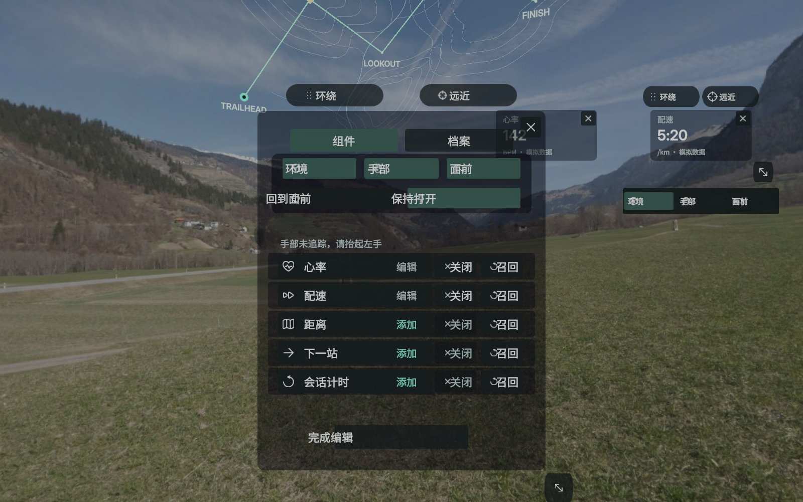
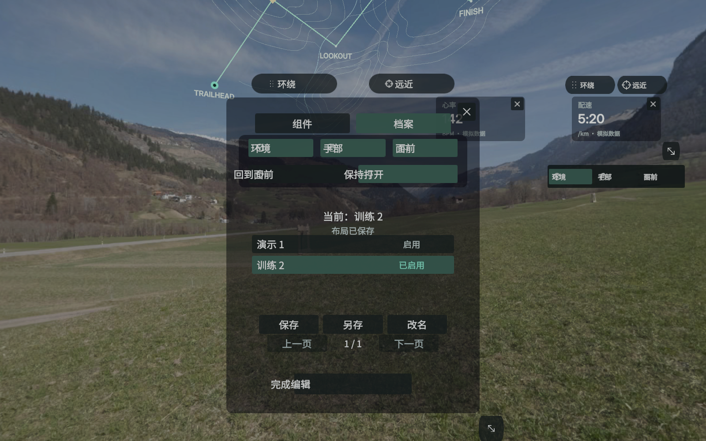

# AeroPulse Quest v0.24.1

本次修复组件工具面板的排版和组件级恢复操作。

- 页签、层控制、组件/档案内容区和“完成编辑”分区显示，不再相互覆盖。
- 每个组件行按“名称 → 添加/编辑 → 关闭 → 召回”排列。
- “召回”会把对应组件重新放到眼前；运动时仍不显示组件关闭键。
- 组件页与档案页通过 Play Mode 截图和矩形不重叠检查。
- 64 个包正常注册；Catalog023、ProfilesUI021、EditMode024 回归通过。
- Android 构建成功：0 错误、6 个既有 Editor 警告；签名、ZIP 与 zipalign 通过。

## 构建

- Android code：40
- APK：`AeroPulse-GlassLab-v0.24.1.apk`
- SHA-256：`4fffae55de796158f8da5da761d67ccebb62b5694869f1ed37c7c1bb57351da3`

本版已完成 Editor 检查和构建核验，Quest 2 的最终文字清晰度、遮挡和手感仍待实机确认。
