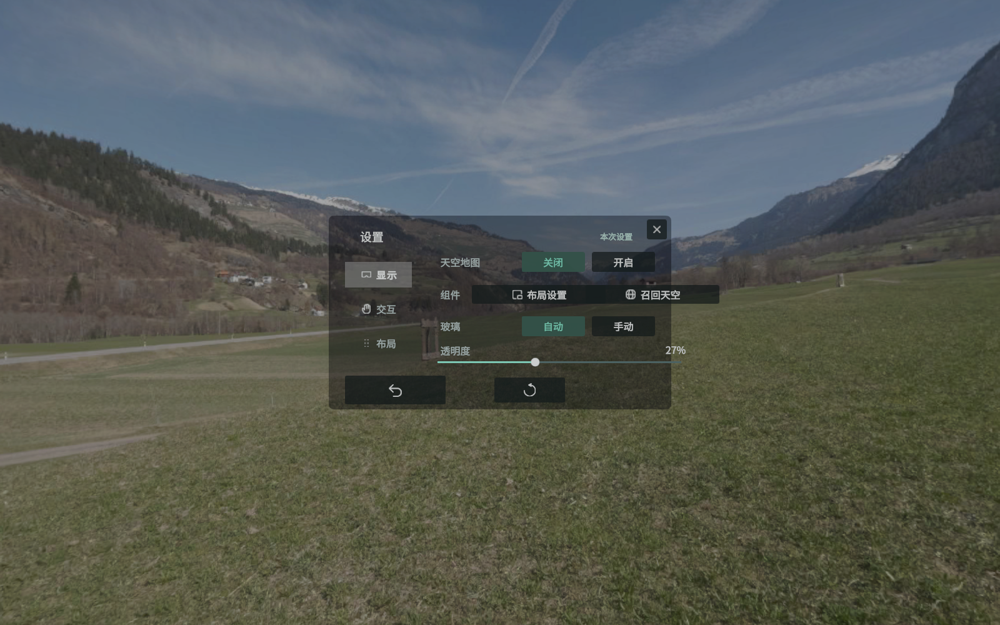

# AeroPulse Quest v0.24.10

本版增加玻璃透明度自动与手动设置。

## 变更

- 设置 → 显示新增“玻璃：自动 / 手动”。
- 自动模式按应用内环境全景亮度在约6%–38%间调整透明度：亮背景更实、暗背景更透。
- 手动模式提供5%–60%滑杆，默认22%，选择会持久保存。
- 透明度统一作用于主卡、组件、工具、弹窗、小读数、移动栏和反馈底板；文字与按钮颜色不随alpha淡化。
- 自动模式不读取Quest Passthrough摄像头，界面不会把它说成实时现实颜色识别。
- 修复设置页视觉证据捕获，拍照前验证主卡、设置页和视口状态。

## 验证

- Catalog023、ProfilesUI021、NativeKeyboard023、Feedback024、GlassOpacity026、Settings016、EditMode024全部通过。
- Impeccable变更扫描无发现。
- Android构建成功：0错误、7个既有Editor警告；签名、ZIP与zipalign通过。
- 构建时ADB未检测到设备，因此本版尚未安装到Quest 2。

## 构建

- Android code：49
- APK：`AeroPulse-GlassLab-v0.24.10.apk`
- SIZE：50,180,925 bytes
- SHA-256：`29c3fe6d9587d41f179cf9390ae72b468b971d0f6901980ddd1cae0c1db536a3`
