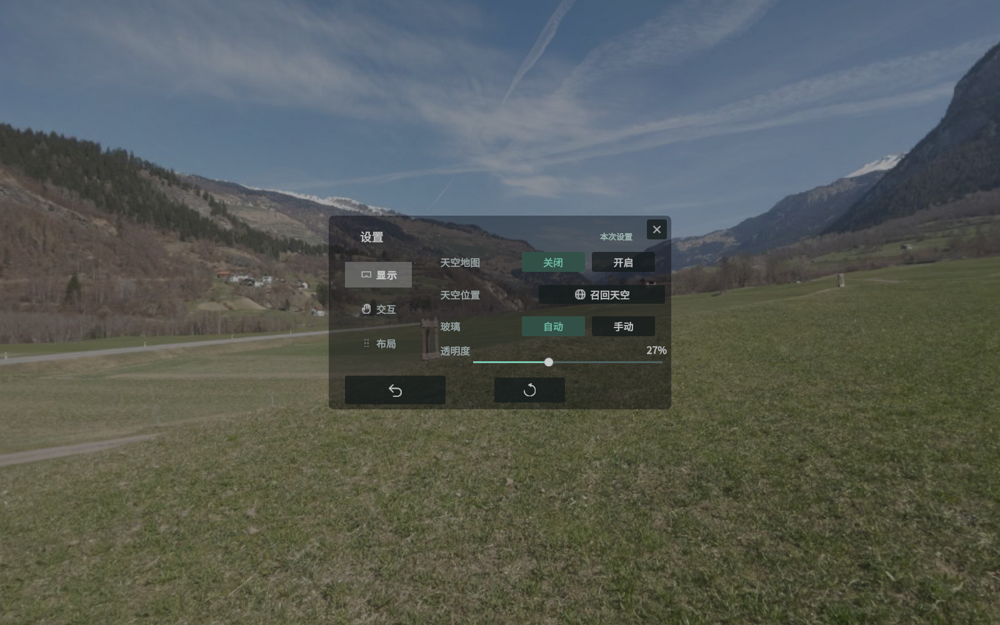

# AeroPulse Quest v0.24.11

本版修正“显示”设置页的重复入口和越界布局。

## 变更

- 移除显示页内重复的“布局设置”，统一从顶部「布局」页进入。
- 原“组件”行改为“天空位置”，仅保留“召回天空”。
- 天空选项、召回天空、玻璃自动/手动和透明度滑杆全部收回主卡安全边界。
- 玻璃透明度滑杆由560单位缩为440单位，百分比和滑块不再贴到或越过卡片右边缘。

## 验证

- Catalog023、ProfilesUI021、NativeKeyboard023、Feedback024、GlassOpacity026、Settings016、EditMode024全部通过。
- 新增显示页无重复布局入口和四个控件的卡片边界断言。
- Impeccable变更扫描无发现。
- Android构建成功：0错误、7个既有Editor警告；签名、ZIP与zipalign通过。
- 构建时ADB未检测到设备，因此本版尚未安装到Quest 2。

## 构建

- Android code：50
- APK：`AeroPulse-GlassLab-v0.24.11.apk`
- SIZE：50,180,541 bytes
- SHA-256：`1c607da487e4c3270a6b048e6015687948abacba13c2db9c081a9c089c228c42`
