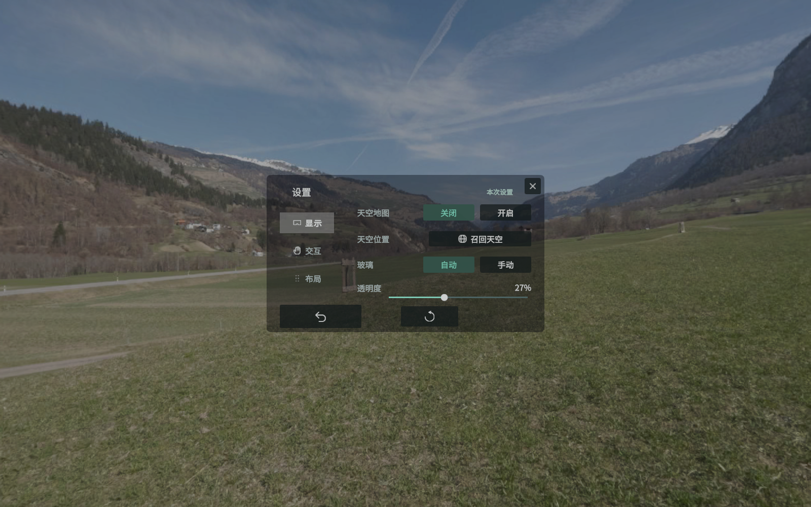

# AeroPulse Quest v0.24.12

本版统一“显示”设置页的左右留白和透明度行距。

## 变更

- 左侧导航、右侧“召回天空”、玻璃选项与透明度滑杆统一到约36单位安全区。
- 透明度滑杆从440单位缩为400单位，轨道、滑块和百分比进一步远离右边缘。
- “透明度”标题下移，滑杆根高度收紧，使行距更接近上方选项。
- 回归将显示控件左右安全区检查提升到32单位。

## 验证

- Catalog023、ProfilesUI021、NativeKeyboard023、Feedback024、GlassOpacity026、Settings016、EditMode024全部通过。
- Impeccable变更扫描无发现。
- Android构建成功：0错误、7个既有Editor警告；签名、ZIP与zipalign通过。
- 构建时ADB未检测到设备，因此本版尚未安装到Quest 2。

## 构建

- Android code：51
- APK：`AeroPulse-GlassLab-v0.24.12.apk`
- SIZE：50,180,549 bytes
- SHA-256：`fa65cdc1fbd887b1461dfb1fe0938db41ac7457facb0e928846ec3749d8fc547`
