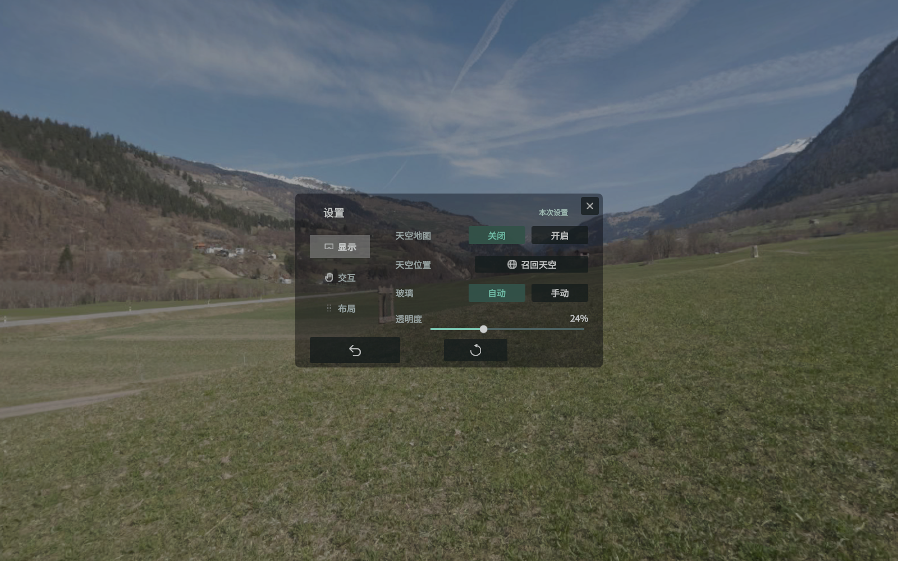

# AeroPulse Quest v0.24.13

本版将自动玻璃透明度改为白字对比度驱动，并加强对太阳等高亮物体的响应。

## 变更

- 自动模式从4个点平均改为视线前方7×5区域采样。
- 背景亮度采用sRGB线性化和Rec.709相对亮度。
- 区域最亮点以40%权重计入，太阳不再容易被整片天空平均掉。
- 白字与背景对比度低时提高不透明度，白背景目标透明度为4%。
- 白字与深背景对比清楚时提高透明度，深背景目标透明度为55%。
- 采样间隔缩短至0.35秒，并加快平滑响应；手动模式保持5%–60%。

## 验证

- Catalog023、ProfilesUI021、NativeKeyboard023、Feedback024、GlassOpacity026、Settings016、EditMode024全部通过。
- 深、中、白三种背景下，目标透明度严格按预期递减。
- Impeccable变更扫描无发现。
- Android构建成功：0错误、7个既有Editor警告；签名、ZIP与zipalign通过。
- 构建时ADB未检测到设备，因此本版尚未安装到Quest 2。

## 构建

- Android code：52
- APK：`AeroPulse-GlassLab-v0.24.13.apk`
- SIZE：50,181,017 bytes
- SHA-256：`b28e6bea830e402cc90c4ed55ce8a79b0f8482deab95c742978c3d6167a0fd52`
