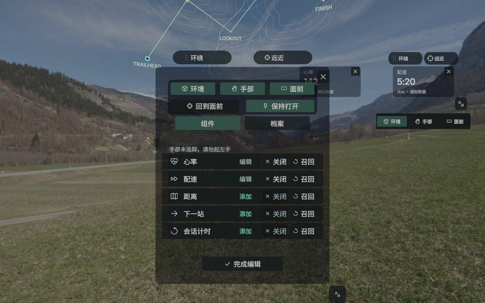
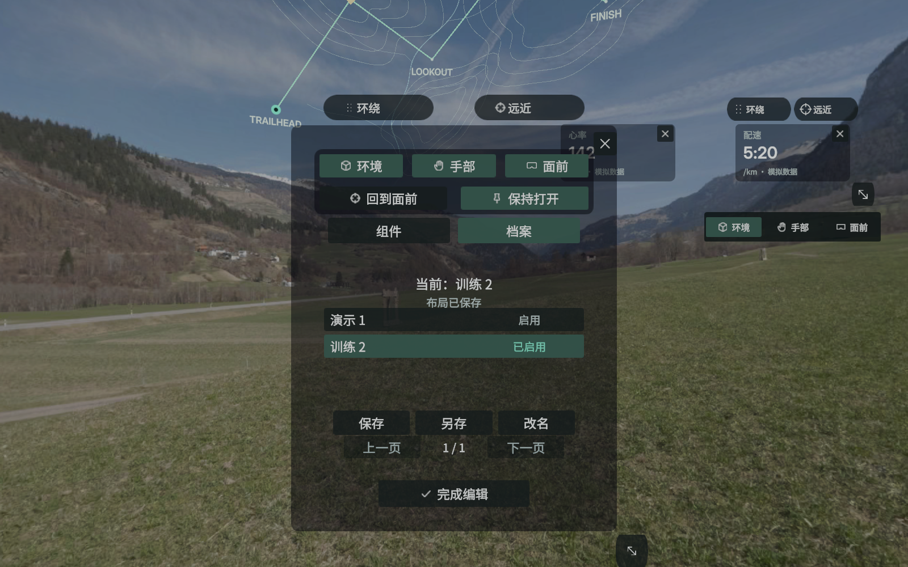

# AeroPulse Quest v0.24.2

本次优化组件工具的顶部控制区与页签顺序。

- “环境 / 手部 / 面前”和“回到面前 / 保持打开”的图标与文字作为整体居中。
- 五个层控制移到“组件 / 档案”页签上方；页签位于控制区与内容列表之间。
- 组件列表及档案列表保持在独立内容区，各行操作不重叠。
- Play Mode 组件页和档案页截图已检查，几何回归继续覆盖按钮中心与区域顺序。
- Catalog023、ProfilesUI021、EditMode024 回归通过；Impeccable 机械扫描无发现。
- Android 构建成功：0 错误、6 个既有 Editor 警告；签名、ZIP 与 zipalign 通过。

## 构建

- Android code：41
- APK：`AeroPulse-GlassLab-v0.24.2.apk`
- SHA-256：`42b14e958adc726ea644c58bcba88c886b9ea4ecea1cbb7bf29a73c50f80047f`

本版已完成 Editor 检查和构建核验，Quest 2 的最终文字对齐、遮挡和手感仍待实机确认。
