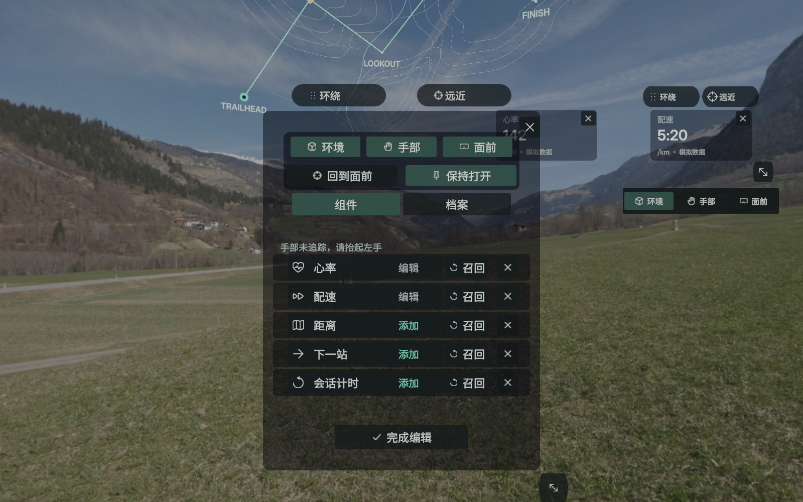
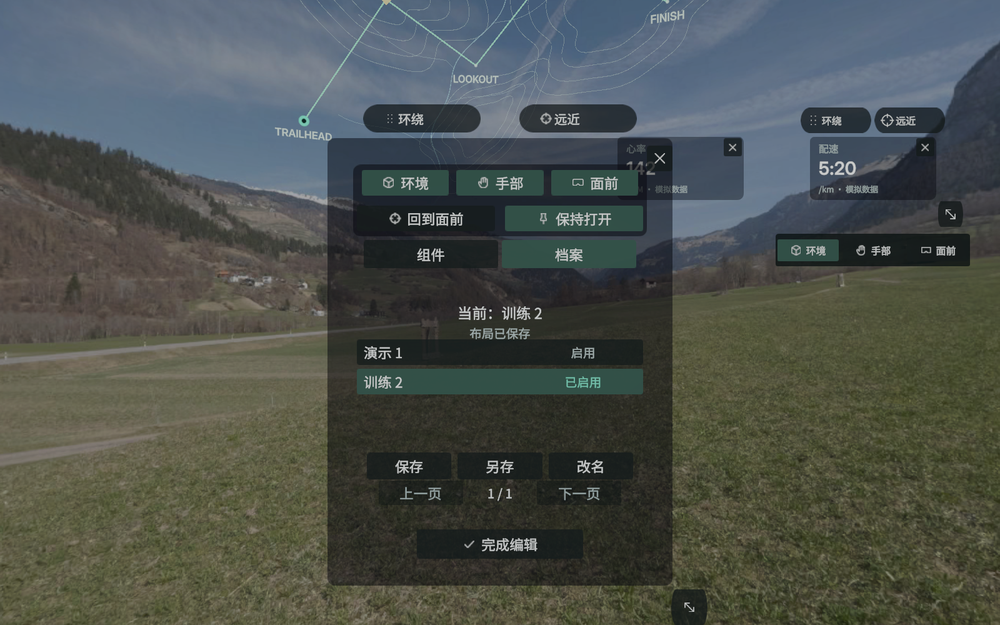

# AeroPulse Quest v0.24.3

本次压缩组件行操作区，并简化关闭动作。

- 关闭按钮移到每行最右侧，只显示叉号。
- 行内顺序改为“添加/编辑 → 召回 → ×”。
- “添加/编辑”和“召回”之间的间距保留，避免误触。
- 组件工具宽度从560收紧到540，内容区从520收紧到500。
- 组件页和档案页截图检查通过，关闭图标位置与文字隐藏均有几何断言。
- Catalog023、ProfilesUI021、EditMode024 回归通过；Impeccable 机械扫描无发现。
- Android 构建成功：0 错误、6 个既有 Editor 警告；签名、ZIP 与 zipalign 通过。

## 构建

- Android code：42
- APK：`AeroPulse-GlassLab-v0.24.3.apk`
- SHA-256：`ef1ee3eca86e92ec988803f1ab93714be523ff46718f6c97e44e4da8d97b6d40`

本版已完成 Editor 检查和构建核验，Quest 2 的最终点击命中、文字清晰度和观感仍待实机确认。
