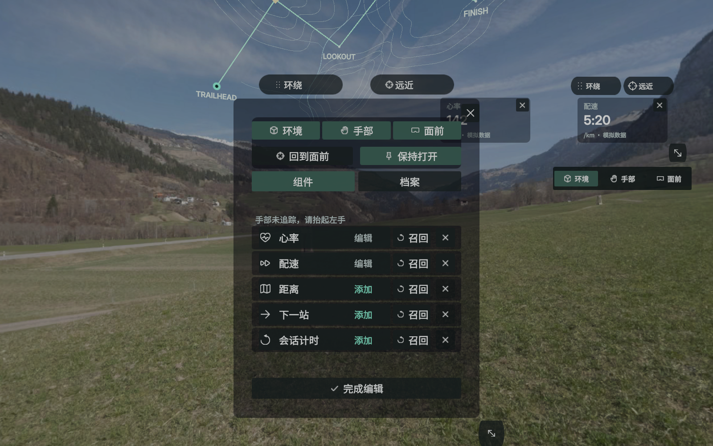
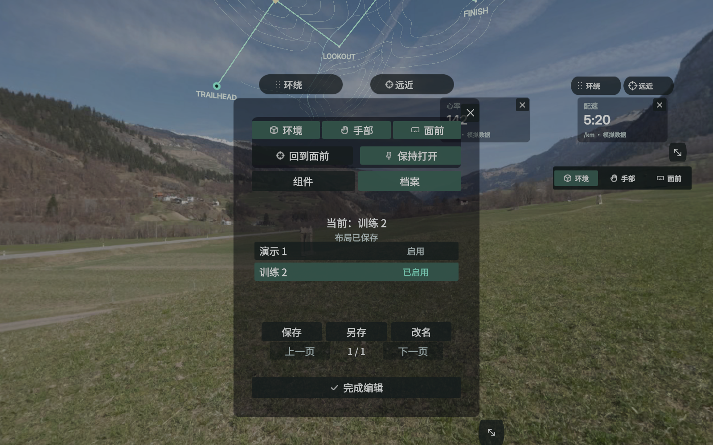

# AeroPulse Quest v0.24.4

本次统一组件工具各区域的左右边界。

- 层控制、组件/档案页签、组件行、档案列表和“完成编辑”统一为460单位内容宽度。
- 第一排三个按钮与第二排两个按钮的外缘也对齐同一左右边界。
- 面板与内容区之间的左右留白保持一致；“完成编辑”改为同宽页脚按钮。
- 组件页与档案页 Play Mode 截图已复核。
- Catalog023、ProfilesUI021、EditMode024 回归通过；Impeccable 机械扫描无发现。
- Android 构建成功：0 错误、6 个既有 Editor 警告；签名、ZIP 与 zipalign 通过。

## 构建

- Android code：43
- APK：`AeroPulse-GlassLab-v0.24.4.apk`
- SHA-256：`5664c56f92dded47761f16911bf92cf6c71b9339e95ba064d149a5856065c068`

本版已完成 Editor 检查和构建核验，Quest 2 的最终对齐观感与点击手感仍待实机确认。
