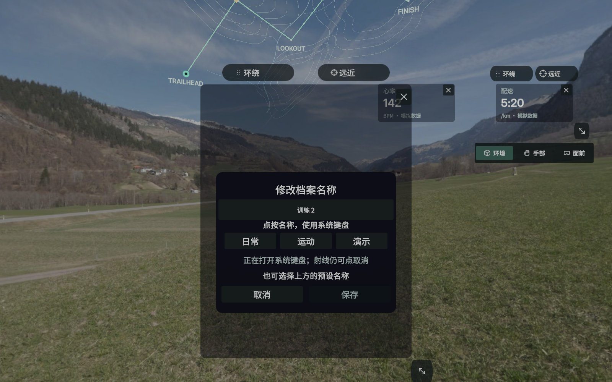

# AeroPulse Quest v0.24.5

本次修复系统键盘未能显示时会锁死输入的问题。

## 行为变化

- 系统键盘打开后先进入“正在打开”状态；键盘真正可见前，不再提前禁用所有输入。
- 键盘等待期间仍保留手部/控制器射线，并把“取消”设为唯一可操作按钮。
- 系统键盘造成应用失焦时，不再暂停和隐藏整个工具面板。
- 键盘 3 秒内未出现时自动关闭本次会话、恢复全部输入，并提示重试或选择预设名称。
- 系统键盘完成、取消或失焦时正确结束输入会话。
- 名称输入框固定使用16单位字体，完整24字符不会越界。

## 验证

- Catalog023、ProfilesUI021、NativeKeyboard023、EditMode024 全部通过。
- NativeKeyboard 覆盖键盘等待态、取消路径、射线的可见性、失焦面板保留和超时恢复。
- Impeccable 机械扫描无发现。
- Android 构建成功：0 错误、6 个既有 Editor 警告；签名、ZIP 与 zipalign 通过。
- 已安装到 Quest 2：`0.24.5/code44`。

## 构建

- Android code：44
- APK：`AeroPulse-GlassLab-v0.24.5.apk`
- SHA-256：`d463bbd4a914ab920fbd6bd4ef4943d27cf8ba96b5f1925b76d0343b46b6281b`

系统键盘的真实显示和中文输入仍需在 Quest 2 上实机确认。
