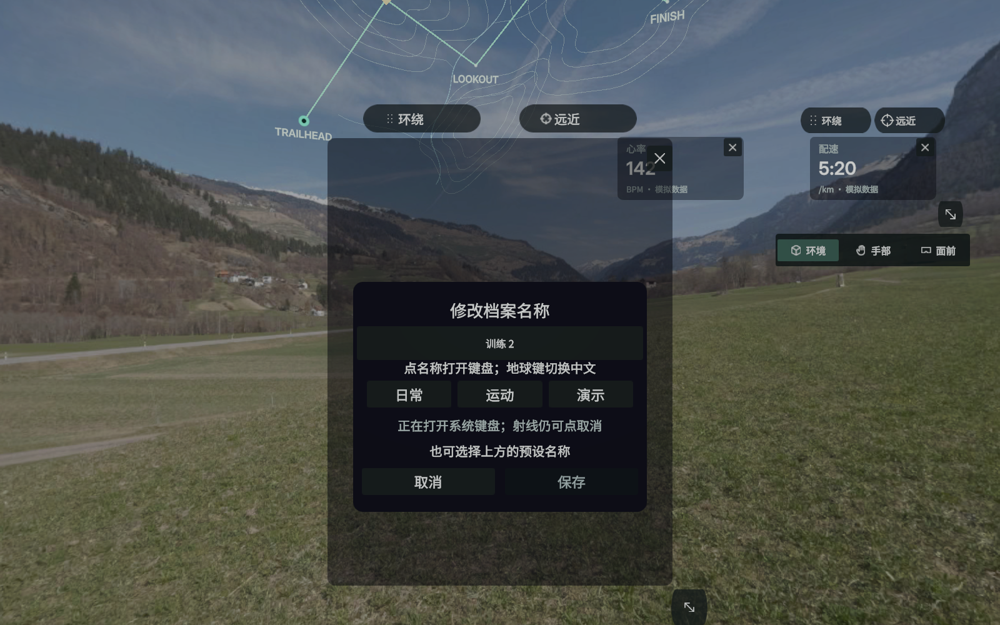

# AeroPulse Quest v0.24.7

本次恢复确认提示音并补充系统键盘中文切换提示。

## 提示音

- 确认提示音默认开启。
- 音效音量提高至0.18。
- 设置中的“提示音 开/关”写入 `PlayerPrefs`，重启应用后保持。
- 新增 AeroFeedback024 回归验证默认值、开关持久化和音量下限。

## 中文输入

Quest 当前系统语言是 `zh-CN`，但实际键盘 subtype 为“英语（美国）”。Unity 没有 API 可以替用户启用系统中文输入法。

Meta 官方说明：系统键盘语言来自 `Settings > System > Language and Region` 中已选择的语言；键盘出现后使用“地球”图标切换语言。

名称弹窗已增加提示：

```text
点名称打开键盘；地球键切换中文
```

## 验证

- Catalog023、ProfilesUI021、NativeKeyboard023、Feedback024、EditMode024 全部通过。
- APK 仍使用 UnityPlayerActivity。
- Android 构建成功：0 错误、7 个既有 Editor 警告；签名、ZIP 与 zipalign 通过。
- 已安装并启动 Quest 2：`0.24.7/code46`。



## 构建

- APK：`AeroPulse-GlassLab-v0.24.7.apk`
- SHA-256：`e28cabeba7b038ddc439ba1ca639bcff3d389416f2ff1483f78e54e5092568bb`
