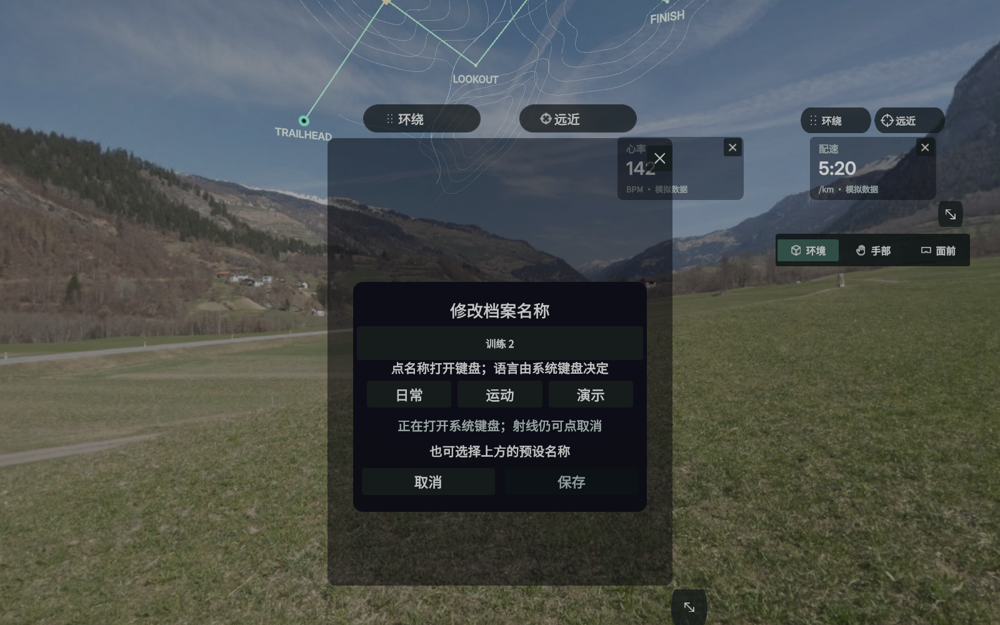

# AeroPulse Quest v0.24.8

本次保留提示音与键盘恢复修复，并纠正系统键盘语言提示。

## 变更

- 系统键盘名称输入框不再承诺“地球键可切换中文”。
- 提示改为“语言由系统键盘决定”。
- 确认提示音继续保持默认开启和持久化。
- 键盘继续使用 UnityPlayerActivity，避免 Quest OS 2.7 的 GameActivity 兼容问题。

## Quest 语言检查

设备当前：

```text
system_locales=zh-CN
Oculus Keyboard subtype=英语（美国）
```

当前 Horizon OS 的“设备 → 虚拟键盘”页面没有语言选择；系统键盘也没有中文 subtype。语言列表入口只能调整系统语言，不能保证增加键盘输入法。

详见 [系统键盘语言说明](https://github.com/devmczdj/AeroPulse-Quest/blob/main/Docs/39_%E7%B3%BB%E7%BB%9F%E9%94%AE%E7%9B%98%E8%AF%AD%E8%A8%80%E8%AF%B4%E6%98%8E.md)。

## 验证

- Catalog023、ProfilesUI021、NativeKeyboard023、Feedback024、EditMode024 全部通过。
- Android 构建成功：0 错误、7 个既有 Editor 警告；签名、ZIP 与 zipalign 通过。
- 已安装并启动 Quest 2：`0.24.8/code47`。



## 构建

- APK：`AeroPulse-GlassLab-v0.24.8.apk`
- SHA-256：`eddb7ffb3403de71ffb1cf0a4849a6cc4d138344ef6d098f14b35fa1d0ce7316`
