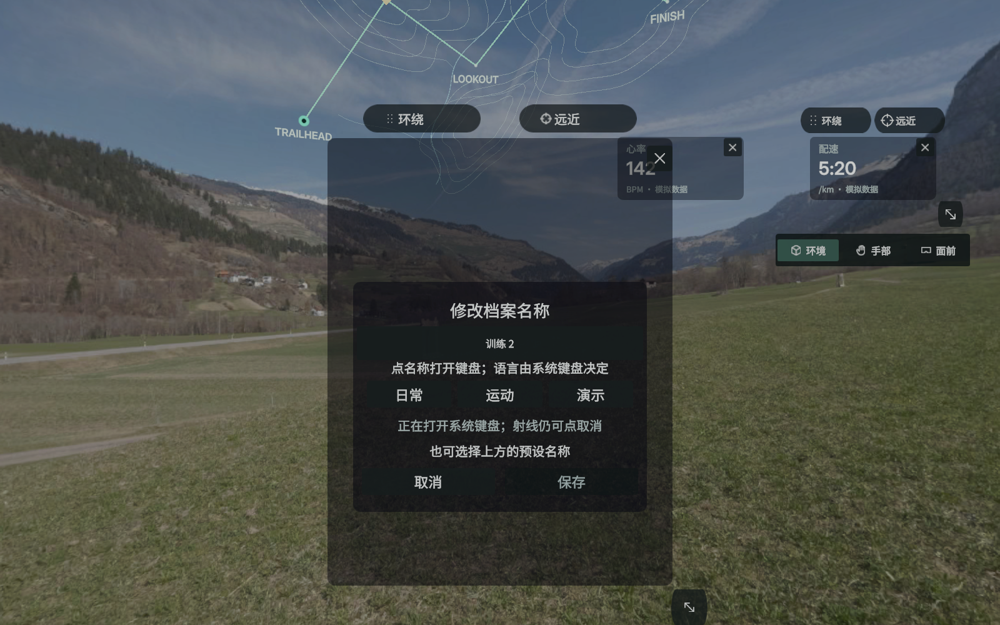

# AeroPulse Quest v0.24.9

本次修复档案名称弹窗遮挡手部射线的问题。

## 变更

- 名称弹窗和“未保存切换”确认框改用 `RoundedRect` 半透明玻璃底板。
- 背景 alpha 为 `0.78`，与主工具面板一致。
- 手部和控制器射线可透过弹窗背景看到。
- NativeKeyboard 回归新增弹窗透明度检查。
- 提示音默认开启与持久化保持不变；用户重启Quest后已确认声音恢复。

## 验证

- Catalog023、ProfilesUI021、NativeKeyboard023、Feedback024、EditMode024 全部通过。
- Impeccable 机械扫描无发现。
- Android 构建成功：0 错误、7 个既有 Editor 警告；签名、ZIP 与 zipalign 通过。
- 构建时 ADB 未检测到设备，因此本版尚未安装到 Quest 2。

## 构建

- Android code：48
- APK：`AeroPulse-GlassLab-v0.24.9.apk`
- SHA-256：`56babd7709ddd202a5f95676abc0b45d3d7fd22c7df2aa4f5fc8cfce59a61d1d`
