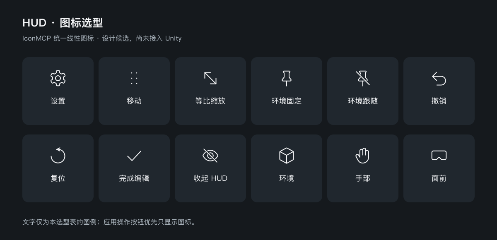

# HUD 图标优先规范（设计候选，待实施）

> 2026-11-16：本方案已在v0.18.0实现并通过相关Editor检查；当前行为和待测边界以[25_操作说明](25_自由布局缩放与图标操作.md)为准。下文保留设计阶段记录。

2026-11-15。用户最新要求：能用明确icon表达的操作，就不用文字描述；设置用齿轮，右下角对角箭头缩放把手优于“捏住缩放”文字。已实际使用 IconMCP 的 search_icons / get_icon 检索并取得SVG，不是用emoji充当成品图标。本轮不启动Unity、不改应用。

图下中文只用于本规范的图例，不是要求按钮重复显示文字。

## 1. 使用原则

- **操作图标优先。** 设置、移动、缩放、固定、撤销、复位、完成、收起以图标表达。去掉常驻“捏住此处移动”“捏住缩放”“图钉：未固定”等文字；熟悉操作也不默认在指向后弹出同一句文字。
- **保留信息内容。** 心率、配速、距离、单位、缩放中的100%、对象名称与必要异常说明保留；图标化不等于删除数据。复位确认中需要说清影响范围的内容仍保留。
- **统一风格。** 本轮候选采用IconMCP outline，圆端点和统一线宽/尺寸；不混入emoji、系统字体符号或另一套风格。最终显示尺寸与线宽需结合Quest画面确定，预览图的48px不是头显验收参数。
- **状态靠图形与交互反馈。** 选中底板/描边、图标形态变化明确当前状态，不能只靠颜色。图标视觉尺寸与点击区域分开，后者保留足够范围且不与相邻按钮重叠。
- **说明集中放到帮助。** 放置方式等项目特有概念在首次帮助/主动打开的帮助图例中解释；常用操作界面保持简洁。内部语义名称保留用于测试和帮助映射，不因隐藏视觉文字而删除。

## 2. 图标映射

| 功能 | IconMCP实际名称 | 用法与边界 |
|---|---|---|
| 设置 | `settings` | 齿轮，替代操作入口的“设置”文字 |
| 移动 | `grip-vertical` | 顶部点阵把手；命中整个抓取条，不只命中小点。不要用手掌表示拖动，否则和手部放置混淆 |
| 等比缩放 | `move-diagonal` | 右下角双向对角箭头；原SVG为左下/右上方向，预览旋转90°得到左上/右下，与缩放路径一致 |
| 环境固定 | `pushpin` | 图钉＋选中状态；表示自动跟随关闭，仍可主动抓条移动 |
| 环境跟随 | `pushpin-off` | 解除图钉；保留原定延迟柔和跟随，不代表删除或隐藏HUD |
| 撤销 | `undo` | 左回弯箭头，只撤销上一步 |
| 复位此HUD | `rotate-ccw` | 环形回转箭头，恢复所选HUD默认布局；不等同召回或撤销 |
| 完成编辑 | `check` | 勾号，退出编辑、保留本次会话布局 |
| 收起HUD | `eye-off` | 划线眼睛，仅隐藏显示、保留布局；不替代完成编辑 |
| 关闭已有弹层 | `close` | ×，仅用于原有关闭职责，不额外新增一个HUD退出按钮 |
| 环境放置 | `cube` | 空间立方体候选，避免地图/云图标与天空层混淆 |
| 手部放置 | `hand-open` | 手掌轮廓，映射左手参考位置；不是必须张开五指的操作指令 |
| 面前放置 | `vr-headset` | 头显/视野轮廓候选；不使用眼睛，避免与显示隐藏混淆 |

底部三种放置图标作为互斥组，以选中底板/描边区分，不额外挂一个“完成”勾号。图标是否能被首次用户正确辨认，尤其环境/面前区别，留待后续交互测试；本表不是已通过可用性验收的结论。

## 3. 右下缩放入口的新口径

采用对角双向箭头作为当前候选，去掉“捏住缩放”的常驻或默认悬停提示。只在编辑且选中HUD时出现；指向高亮，捏住后保持抓取反馈，拖动期间显示百分比，松手后停止反馈。实际命中区域可大于图形，须避开完成按钮。保持左上支点、宽高比、尺寸限制和撤销/取消规则；此次只修正表达，不改变布局方案的交互语义。

用户此前提供的圆角白弧是视觉参考，当前以本轮明确的图标优先和对角箭头偏好为准，不再将“仅白弧、不用箭头”作为强制规则。

## 4. 文件与实施范围

- `Docs/24_Icons/01_preview.png`：候选表，已渲染查看。
- `Docs/24_Icons/02_preview.svg`：同表矢量版本。
- `Docs/24_Icons/03_icons.json`：13枚IconMCP原始SVG及返回元数据；缩放箭头原始数据不旋转，呈现时旋转90°。
- 来源：IconMCP（https://iconmcp.com），本次实取工具名为search_icons/get_icon，统一outline参数。原始SVG保存于文档素材目录，未导入Unity Assets。
- 后续实施优先复用本地图标资产（Sprite/合适的矢量方案），不在Quest运行时联网取图标，也不将React组件库作为Unity运行依赖。
- [布局方案](https://github.com/devmczdj/AeroPulse-Quest/blob/main/Docs/23_HUD自由布局方案.md)同步采用本规范；运行版本仍v0.17.1，五项P2尚未修复。
