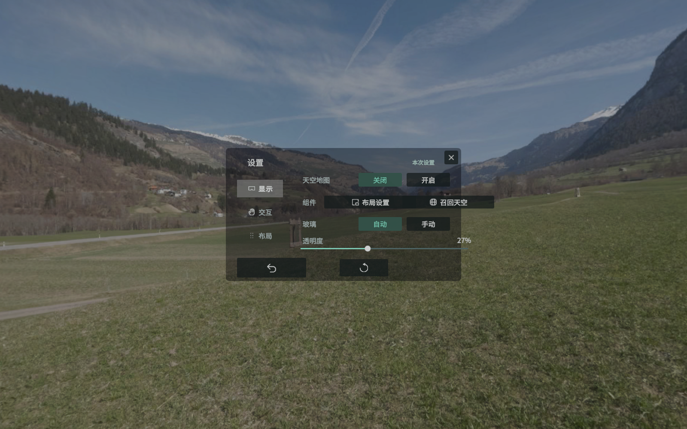

# 玻璃透明度自动与手动

版本：v0.24.10（Android code 49），2026-11-21。

## 需求

设置应能跟随环境明暗调整 HUD 玻璃透明度，也应允许用户自己指定透明度。

## 已实现

设置 → 显示新增两组控件：

- **玻璃**：选择 `自动` 或 `手动`。
- **透明度**：手动模式滑杆范围 5%–60%，默认 22%。

自动模式每 0.5 秒按当前视线方向采样应用内 `AeroGlassPanorama` 环境立方体贴图的四个区域。亮度越低，玻璃越透明；亮度越高，玻璃越实，以兼顾暗背景可见性和亮背景文字对比度。有效范围约为 6%–38%。

手动值写入 PlayerPrefs：

- `AeroPulse.GlassOpacityMode`
- `AeroPulse.GlassManualTransparency`

“恢复默认”会重新启用自动模式并清除手动透明度覆盖。

## 现实边界

Quest 不允许 Unity 应用直接读取 Passthrough 摄像头纹理。因此这里的“自动识别背景”是读取应用内可用的环境全景图，不会读取现实摄像头画面，也不应对外表述为实时 Passthrough 颜色识别。

## 覆盖范围

透明度只作用于注册为 `AeroGlassSurface` 的半透明底板，包括：

- 主 HUD
- 小组件行与组件工具
- 名称编辑和未保存确认弹窗
- 视野小读数
- 面板移动工具栏
- 交互反馈底板

标题、数值、图标和按钮填充颜色独立于玻璃 alpha，避免透明度提高后文字一起变淡。

## 验证

- `AeroGlassOpacity026Checks`：自动/手动切换、环境亮度范围、统一 alpha 乘数和重置。
- `AeroSettingsChecks`：设置页真实射线选择、滑杆和默认恢复。
- Catalog、档案、系统键盘、反馈和编辑模式回归全部通过。
- 设置页截图在拍照前强制检查主卡可见、设置页已激活、当前页为“显示”、Canvas alpha 可见且主卡位于视口中央。
- Impeccable 变更扫描：无发现。

## 构建

- Android code：49
- APK：50,180,925字节
- SHA-256：`29c3fe6d9587d41f179cf9390ae72b468b971d0f6901980ddd1cae0c1db536a3`
- 签名、ZIP完整性、zipalign：通过

构建和发布核验时 ADB 未检测到 Quest 2，实机观感与手部操作待连接后确认。
