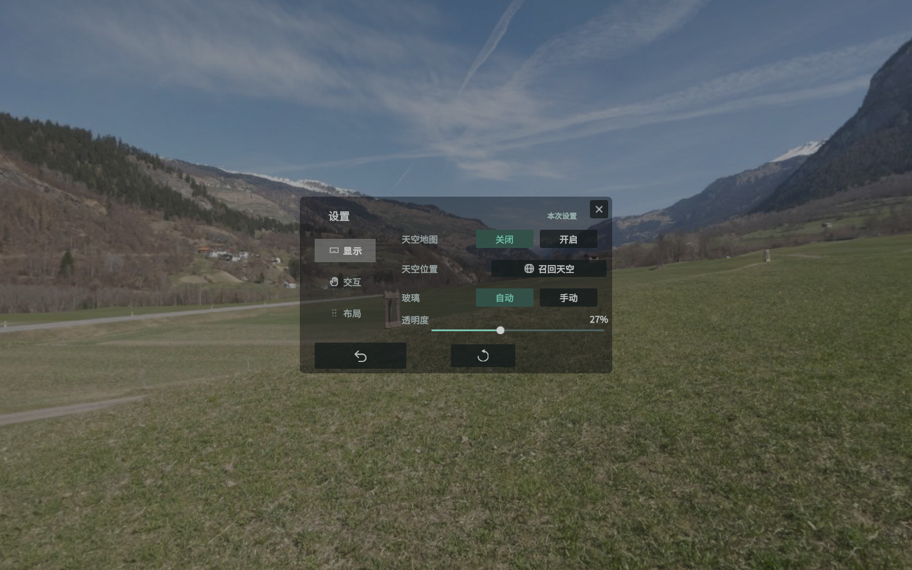

# 显示页去重与透明度滑杆边界

版本：v0.24.11（Android code 50），2026-11-21。

## 问题

「显示」页同时存在“布局设置”按钮和顶部「布局」页，入口重复；该按钮与“召回天空”组成一行后，右侧越出760单位主卡边界。玻璃透明度滑杆宽560单位，同样把轨道末端和百分比推到卡片外。

## 调整

- 删除「显示」页的“布局设置”按钮，布局设置只从顶部「布局」页进入。
- 原“组件”标题改为“天空位置”，行内只保留“召回天空”。
- “召回天空”按钮改为280单位宽，放在内容列内。
- 玻璃透明度滑杆由560单位缩为440单位，向右移动至可用内容边界。
- “透明度”标题、自动/手动按钮、轨道、滑块和百分比全部保持在主卡内。

## 回归

Settings016新增检查：

- 显示页不存在名为`WidgetLibrary`的重复入口。
- “天空位置”标题存在。
- 天空选项、召回天空、玻璃选项和透明度滑杆的四个世界坐标角点均位于主卡内边界8单位以上。
- 顶部「布局」页仍能打开布局设置，且不会直接进入编辑。

Catalog023、ProfilesUI021、NativeKeyboard023、Feedback024、GlassOpacity026、Settings016和EditMode024全部通过；Impeccable变更扫描无结果。

## 截图

## 构建

- Android code：50
- APK：50,180,541字节
- SHA-256：`1c607da487e4c3270a6b048e6015687948abacba13c2db9c081a9c089c228c42`
- 签名、ZIP完整性和zipalign：通过

构建时ADB未检测到Quest 2，实机观感待连接后确认。
