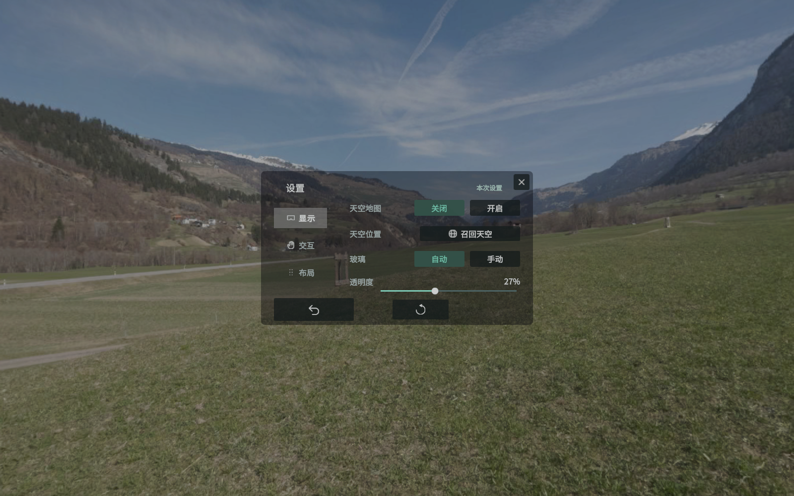

# 显示页对称留白与透明度行距

版本：v0.24.12（Android code 51），2026-11-21。

## 问题

左侧导航距卡片边缘约36单位，但右侧“召回天空”、玻璃选项和透明度滑杆距右边缘只有约3–15单位。透明度标题与轨道之间的垂直节奏也比上方几行更紧。

## 调整

- 左侧导航保持约36单位安全区。
- “召回天空”宽度保持280单位并左移，与“自动 / 手动”按钮共用相同右边界。
- 玻璃透明度滑杆从440单位缩至400单位，并与上方选项共用右边界。
- “透明度”标题下移10单位。
- 滑杆根高度从54缩至40，轨道与底部按钮之间保留空间。
- 百分比数值、滑块和轨道终点不再接近右边缘。

## 回归

Settings016现在要求导航、天空选项、召回天空、玻璃选项和透明度滑杆在左右方向至少保留32单位安全区，垂直方向至少保留8单位。视觉预览确认左右留白接近，透明度行距更接近上方选项。

Catalog023、ProfilesUI021、NativeKeyboard023、Feedback024、GlassOpacity026、Settings016和EditMode024全部通过；Impeccable变更扫描无结果。

## 截图

## 构建

- Android code：51
- APK：50,180,549字节
- SHA-256：`fa65cdc1fbd887b1461dfb1fe0938db41ac7457facb0e928846ec3749d8fc547`
- 签名、ZIP完整性和zipalign：通过

构建时ADB未检测到Quest 2，实机观感待连接后确认。
