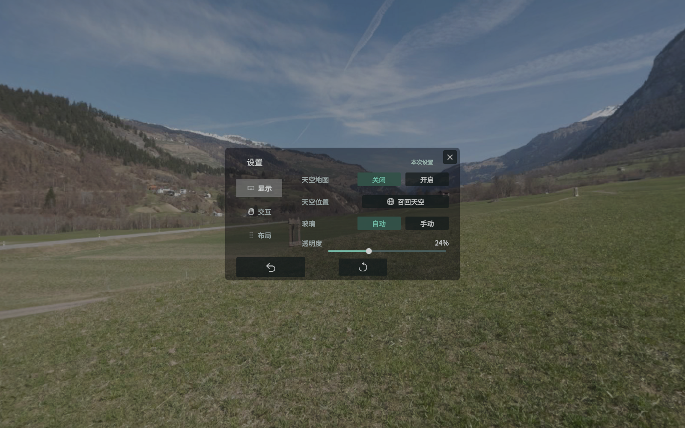

# 白字对比度驱动玻璃透明度

版本：v0.24.13（Android code 52），2026-11-21。

## 目标

HUD 的文字和主要图标为浅色。背景越白，白字与背景越接近，玻璃应更不透明；背景越深，白字对比越明显，玻璃可以提高透明度。

旧自动模式只平均正前方及三个偏下方向，太阳等局部高光很容易被普通天空或地面平均掉。

## 新算法

1. 以当前视线为中心，在水平和垂直方向采样 `7×5` 共35个点。
2. 将每个sRGB颜色线性化，再按Rec.709权重计算相对亮度。
3. 中央样本权重更高，同时将区域最亮点以40%权重计入最终背景亮度。
4. 计算白色文字与背景亮度的WCAG对比度。
5. 对比度低于3时趋于不透明，目标透明度为4%；对比度高于7时趋于透明，目标透明度为55%。
6. 每0.35秒重新采样，并平滑调整，避免转头时透明度跳变。

最终仍通过统一alpha乘数作用于玻璃底板，文字和图标颜色不一起衰减。手动模式保持5%–60%并写入PlayerPrefs。

## 边界

当前自动模式读取应用内`AeroGlassPanorama`全景，不读取Quest Passthrough摄像头。它能让应用内太阳、天空、地面等方向产生更明显的差异，但现实房间的颜色仍不会参与计算。

## 验证

- 深背景目标透明度不低于54%。
- 白背景目标透明度不高于4.1%。
- 深、中、白三种背景的目标透明度严格递减。
- 测试视角记录：背景相对亮度0.161、白字对比度4.714、自动透明度24.1%。
- Catalog023、ProfilesUI021、NativeKeyboard023、Feedback024、GlassOpacity026、Settings016和EditMode024全部通过。
- Impeccable变更扫描无结果。

## 构建

- Android code：52
- APK：50,181,017字节
- SHA-256：`b28e6bea830e402cc90c4ed55ce8a79b0f8482deab95c742978c3d6167a0fd52`
- 签名、ZIP完整性和zipalign：通过

构建时ADB未检测到Quest 2，实机观感待连接后确认。
