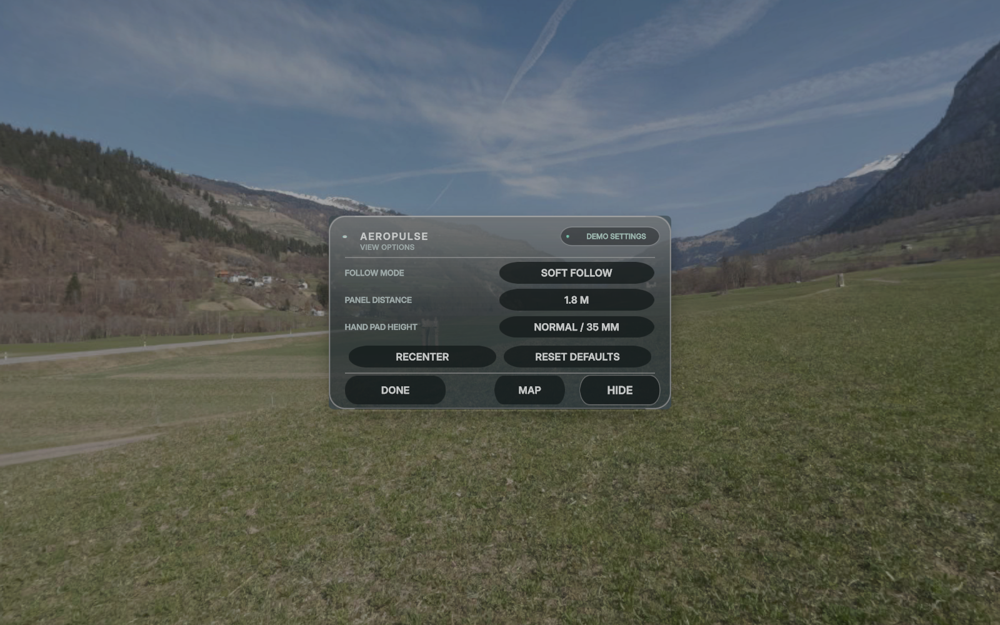

# AeroPulse Quest

AeroPulse Ultra课程概念的Meta Quest 2交互原型：手背轻触调出运动HUD、查看示意路线，并调整面板跟随方式。

**当前v0.12.0为自动验证预发布，最终Quest试戴待做。** [下载预发布APK](https://github.com/devmczdj/AeroPulse-Quest/releases/tag/v0.12.0) · [操作与构建](Docs/01_运行与验证.md) · [计划](Docs/02_分步计划.md)

## 功能

- [编辑布局与手部快捷](Docs/12_布局与手部快捷.md)：显式拖拽把手、WORLD/VIEW/HAND停靠、撤销/复位与丢手召回。

- 小型视野读数左/右/隐藏、独立锚定与可选OPEN HUD备用入口。
- 天空透明区域地图与前方细看共用路线/位置，支持推进、召回、收起与重开。
- 左手手背HUD/HIDE片，右食指先离开再轻触打开/收起；失追踪恢复不自动触发。
- 固定模拟心率/配速/距离、数据与5站示意地图切换，当前位置/下一站、ADVANCE/RESET、关闭重开保持会话状态。
- SOFT/QUICK/FIXED、面板距离、手背显示高度、召回/默认复位；设置仅在当前会话生效。
- 原自由手部射线、新捏合门控与真实命中反馈。

触碰通过XR关节距离估计，尚未完成v0.9.1实际遮挡/触碰手感/性能验收；无真实体征、GPS、路线规划或地物配准。玻璃仍为静态全景近似。

## 打开项目

使用Unity **6000.6.8f1**及Android Build Support（SDK/NDK/OpenJDK），让Unity按Packages恢复依赖，打开Assets/Scenes/SampleScene.unity；构建前在Build Profiles激活Android目标。完整CLI步骤与Quest操作见[运行说明](Docs/01_运行与验证.md)。首次依赖导入需联网；原型场景没有云端数据服务。

main输出到Builds/，可选AEROPULSE_ARCHIVE_DIR用于本机外部归档。历史tag v0.9.1保留原构建源码；main单独整理Editor路径，不把这项整理写成重新生成了发布APK。

## 目录与版本

Assets为场景/脚本/材质/字体及必要样例；Packages锁定依赖；ProjectSettings保留实际Unity设置；DESIGN.md定义视觉；Docs保存操作、计划、许可和验证证据。Library、Temp、Logs、UserSettings、Builds、APK和本地凭据不入Git。

main保存可构建代码；每个修复使用短期分支及可审阅差异；Issues记录复现与验收，Release/tag/APK SHA-256对应。旧版课程文档、录屏与源码ZIP仍保留本地。大资源后续按实际需要引入Git LFS。

[第三方许可与来源](Docs/03_第三方许可.md) · [版本校验](Docs/04_v091_发布校验.json) · [Editor证据](Docs/05_v091_编辑器验证.json) · [Quest状态](Docs/06_v091_Quest待测记录.json)

## 文档索引

| 文件 | 内容 |
|---|---|
| [01_运行与验证](Docs/01_运行与验证.md) | Unity/CLI构建、手背操作与测试范围 |
| [02_分步计划](Docs/02_分步计划.md) | 当前实现、待测与后续顺序 |
| [03_第三方许可](Docs/03_第三方许可.md) | 字体、JetStyle、Unity样例及全景来源 |
| [04_发布校验](Docs/04_v091_发布校验.json) | APK与原始构建源码哈希 |
| [05_Editor验证](Docs/05_v091_编辑器验证.json) | v0.9.1电脑端检查证据 |
| [06_Quest状态](Docs/06_v091_Quest待测记录.json) | 未实机验证的范围与下一次试戴 |
| [07_设置预览](Docs/07_设置编辑器预览.png) | 编辑器相机预览，非头显截图 |
| [08_迭代记录](Docs/08_迭代记录.md) | Git接入和后续每轮记录入口 |
| [09_XR Hands许可](Docs/09_XRHands_LICENSE.md) | 原依赖包LICENSE副本 |

[自动迭代账本](Docs/10_自动迭代计划.md) · [本地构建后的发布工具](Tools/01_publish_release.py)

[天空总览编辑器预览](Docs/11_Releases/0.10.0-sky.png) · [前方细看预览](Docs/11_Releases/0.10.0-detail.png) · [0.10.0自动验证](Docs/11_Releases/0.10.0-editor.json)

[左侧小读数预览](Docs/11_Releases/0.11.0-left.png) · [右侧预览](Docs/11_Releases/0.11.0-right.png) · [0.11.0自动验证](Docs/11_Releases/0.11.0-editor.json)
