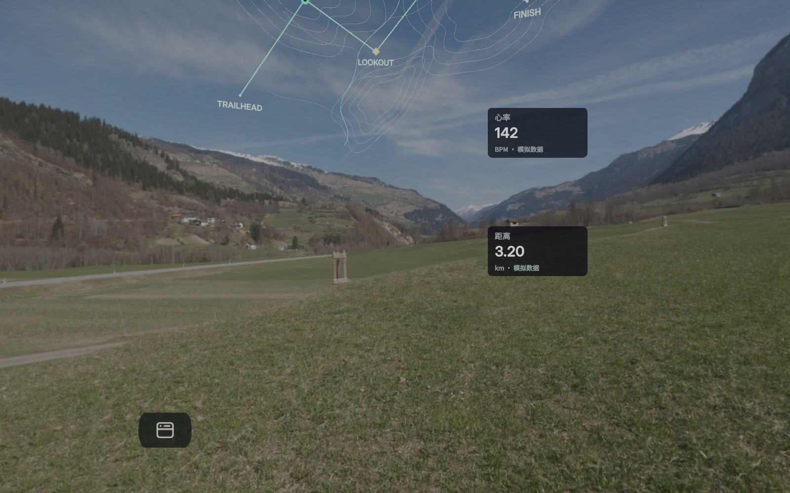

# AeroPulse Quest

AeroPulse Ultra课程概念的Meta Quest 2交互原型：手背轻触调出运动HUD、查看示意路线，并调整面板跟随方式。

**当前源码 v0.22.3（Android code 25）：进入「编辑布局」时工具面板默认收起并提示左手手背快速设置；面板右上角 × 只收起面板，主卡 × 只控制主 HUD。** [上一版 v0.22.1 下载](https://github.com/devmczdj/AeroPulse-Quest/releases/tag/v0.22.1) · [操作与构建](Docs/01_运行与验证.md) · [计划](Docs/02_分步计划.md)

**中期汇报同学先读：[项目说明与素材清单](Docs/22_中期汇报项目说明.md)**（2026-11-15；含版本状态、五项待修问题与素材来源）。仓库已公开；历史说明保留原快照。当前操作见[布局编辑说明](Docs/30_按需工具与分层编辑.md)。

## 功能

- 日常使用左手手背开关主 HUD，按预设查看各项数据。进入「设置 → 布局 → 编辑布局」才显示右手工具、组件关闭按钮和编辑把手。点「完成编辑」回到日常查看。
- 进入编辑布局时工具面板保持收起，先显示“左手手背轻触设置”的指引；右手手背工具键可重新打开面板，面板 × 只收起面板。编辑时可单次或连续添加组件、按层调整或预览全部，并可用系统键盘命名布局档案。详见[按需工具与分层编辑](Docs/30_按需工具与分层编辑.md)。

- [布局档案与近手抓取](Docs/28_布局档案与近手抓取.md)：命名保存、另存、改名和快速启用；未保存切换确认，重启恢复最近档案。最多12个，不保存模拟读数或计时进度。
- 五种独立组件：心率、配速、距离、下一站、会话计时。编辑时点列表添加或用射线拖出，同一组件只显示一份，可点 × 单独移除。日常收起主卡时，已启用组件继续显示。
- 环境、手部、面前三种放置：环绕/远近与手背平移/离手高度分开，右下角80%–150%等比缩放，文字保持正向。
- 近处张开手指靠近把手，再捏住调整；远处保留自由射线。单手捕获、失追踪回滚、释放后重新武装，避免近远输入重复触发。
- 左手手背HUD/HIDE片、右食指轻触；左侧设置分类与连续滑块、近处食指点按。常见动作图标化，设置选项保留短标签。
- 独立天空环境地图：无窗口按钮，随人位移、转头保持方向并缓慢回归；HUD开关不影响天空。示意路线、下一站和演示推进共用会话状态。
- 原型离线运行。心率/配速/距离为固定模拟数据，路线为示意；会话计时仅表示应用运行时长。

v0.22.0 已在 Quest 2 上使用。v0.22.1 的运动中误触、实际遮挡与操作手感仍需佩戴验收。档案的环境位置每次启用会按当前视点重建，不是房间空间锚。无真实体征、GPS或地物配准，玻璃仍为静态全景近似。

## 打开项目

使用Unity **6000.6.9f1**及Android Build Support（SDK/NDK/OpenJDK），让Unity按Packages恢复依赖，打开Assets/Scenes/SampleScene.unity；构建前在Build Profiles激活Android目标。完整CLI步骤与Quest操作见[运行说明](Docs/01_运行与验证.md)。首次依赖导入需联网；原型场景没有云端数据服务。

main输出到Builds/，可选AEROPULSE_ARCHIVE_DIR用于本机外部归档。历史tag v0.9.1保留原构建源码；main单独整理Editor路径，不把这项整理写成重新生成了发布APK。

## 目录与版本

Assets为场景/脚本/材质/字体及必要样例；Packages锁定依赖；ProjectSettings保留实际Unity设置；DESIGN.md定义视觉；Docs保存操作、计划、许可和验证证据。Library、Temp、Logs、UserSettings、Builds、APK和本地凭据不入Git。

main保存可构建代码；每个修复使用短期分支及可审阅差异；Issues记录复现与验收，Release/tag/APK SHA-256对应。旧版课程文档与录屏保留本地；旧源码ZIP已逐个云端回读核验后清理，按历史归档清单恢复。大资源后续按实际需要引入Git LFS。

[第三方许可与来源](Docs/03_第三方许可.md) · [版本校验](Docs/04_v091_发布校验.json) · [Editor证据](Docs/05_v091_编辑器验证.json) · [Quest状态](Docs/06_v091_Quest待测记录.json)

## 文档索引

| 文件 | 内容 |
|---|---|
| [01_运行与验证](Docs/01_运行与验证.md) | Unity/CLI构建、手背操作与测试范围 |
| [02_分步计划](Docs/02_分步计划.md) | 当前实现、待测与后续顺序 |
| [03_第三方许可](Docs/03_第三方许可.md) | 字体、JetStyle、Unity样例及全景来源 |
| [04_发布校验](Docs/04_v091_发布校验.json) | APK与原始构建源码哈希 |
| [05_Editor验证](Docs/05_v091_编辑器验证.json) | v0.9.1电脑端检查证据 |
| [06_Quest状态](Docs/06_v091_Quest待测记录.json) | 未实机验证的范围与下一次试戴 |
| [07_设置预览](Docs/11_Releases/0.17.1-display.png) | 编辑器相机预览，非头显截图 |
| [08_迭代记录](Docs/08_迭代记录.md) | Git接入和后续每轮记录入口 |
| [09_XR Hands许可](Docs/09_XRHands_LICENSE.md) | 原依赖包LICENSE副本 |

[自动迭代账本](Docs/10_自动迭代计划.md) · [本地构建后的发布工具](Tools/01_publish_release.py)

[天空总览编辑器预览](Docs/11_Releases/0.10.0-sky.png) · [前方细看预览](Docs/11_Releases/0.10.0-detail.png) · [0.10.0自动验证](Docs/11_Releases/0.10.0-editor.json)

[左侧小读数预览](Docs/11_Releases/0.11.0-left.png) · [右侧预览](Docs/11_Releases/0.11.0-right.png) · [0.11.0自动验证](Docs/11_Releases/0.11.0-editor.json)

[演示旅程](Docs/13_Demo/01_演示旅程与分镜.md) · [能力证据](Docs/13_Demo/02_证据与能力映射.md) · [商业假设与问答](Docs/13_Demo/03_商业假设与问答.md) · [路演PPT](Docs/13_Demo/04_路演演示.pptx) · [模拟众筹长图](Docs/13_Demo/05_模拟众筹长图.png) · [HUD序列GIF](Docs/13_Demo/06_HUD流程.gif)

[最终验收与安装](Docs/14_最终验收与安装.md) · [发布历史审计工具](Tools/02_audit_release_history.py)

[0.15响应与独立天空说明](Docs/15_响应与独立天空.md) · [天空运行时预览](Docs/11_Releases/0.15.0-sky.png) · [HUD共存预览](Docs/11_Releases/0.15.0-coexist.png)

[Product Design交互审查与待办（待实施）](Docs/16_交互优化待办.md)

[固定分类导航与成熟控件方案（待实施）](Docs/17_设置导航方案.md)

[0.16固定设置与反馈操作](Docs/18_固定设置与反馈操作.md) · [交互页预览](Docs/11_Releases/0.16.0-input.png) · [布局页预览](Docs/11_Releases/0.16.0-layout.png)

[0.17操作与验证](Docs/19_右侧分类与食指触碰.md) · [设置设计约束](Docs/20_设置界面设计约束.md) · [滑块预览](Docs/11_Releases/0.17.0-input.png)

[0.17.1左侧设置导航](Docs/21_左侧设置导航.md) · [左侧分类与滑块预览](Docs/11_Releases/0.17.1-input.png)

[中期汇报项目说明与素材清单](Docs/22_中期汇报项目说明.md)

[HUD自由布局方案（待实施）](Docs/23_HUD自由布局方案.md)：顶部抓取条、底部三种放置方式、环境图钉与独立偏移；本轮仅讨论，Unity保持关闭。

[24_图标优先规范与IconMCP候选](Docs/24_图标优先规范.md)：齿轮设置、对角缩放、点阵移动和状态图标；仅设计候选，未接入应用。

[25_自由布局、缩放与图标操作](Docs/25_自由布局缩放与图标操作.md) · [v0.18布局预览](Docs/11_Releases/0.18.0-layout.png) · [缩放预览](Docs/11_Releases/0.18.0-resize.png)

[26_环绕与远近操作](Docs/26_环绕与远近编辑.md) · [简化布局](Docs/11_Releases/0.19.0-layout.png)

[27_组件操作说明](Docs/27_组件管理与窗口朝向.md) · [五组件预览](Docs/11_Releases/0.20.0-widgets.png)

[28_布局档案与近手抓取](Docs/28_布局档案与近手抓取.md) · [档案页](Docs/11_Releases/0.21.0-profiles.png) · [命名](Docs/11_Releases/0.21.0-name.png) · [0.21自动检查](Docs/11_Releases/0.21.0-editor.json)

[29_总体代码审查与优化](Docs/29_总体代码审查与优化.md)：四项输入/布局修复、两项发布校验改进与无效准星清理，含复现和验证边界。

[30_按需工具与分层编辑](Docs/30_按需工具与分层编辑.md) · [全部预览](Docs/11_Releases/0.22.0-preview.png) · [中文名称](Docs/11_Releases/0.22.0-name.png)
